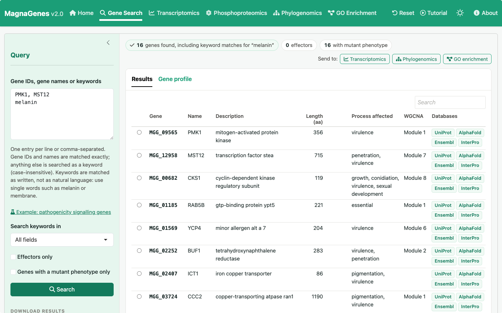
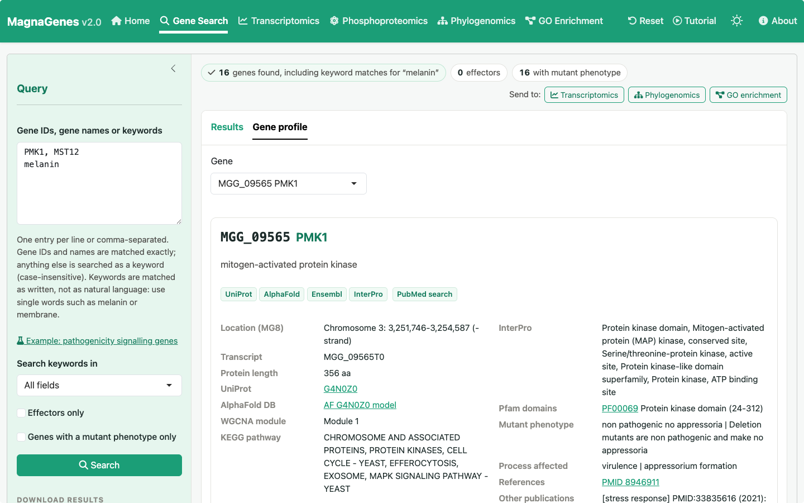
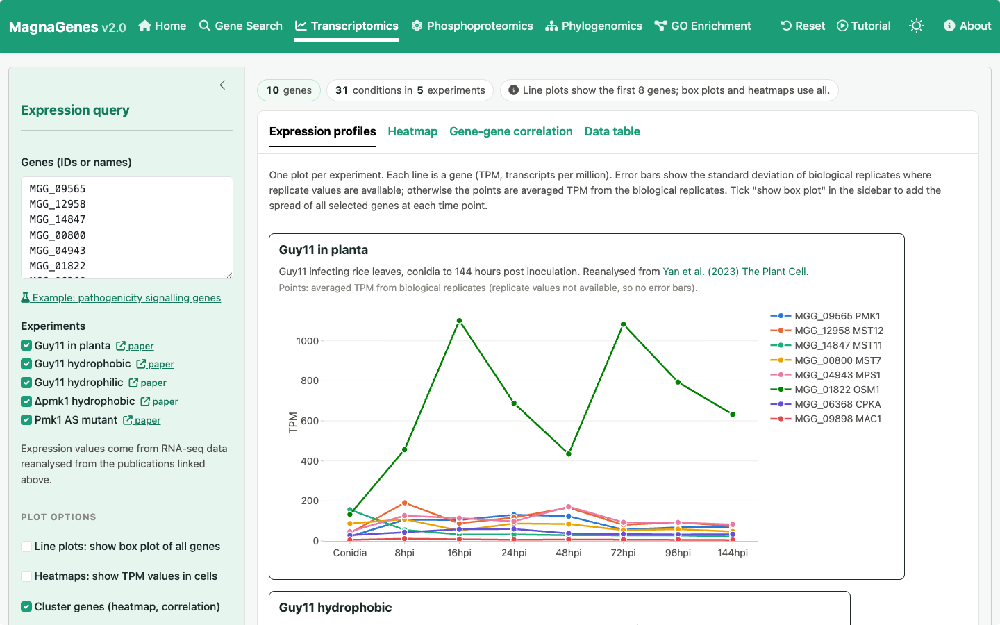
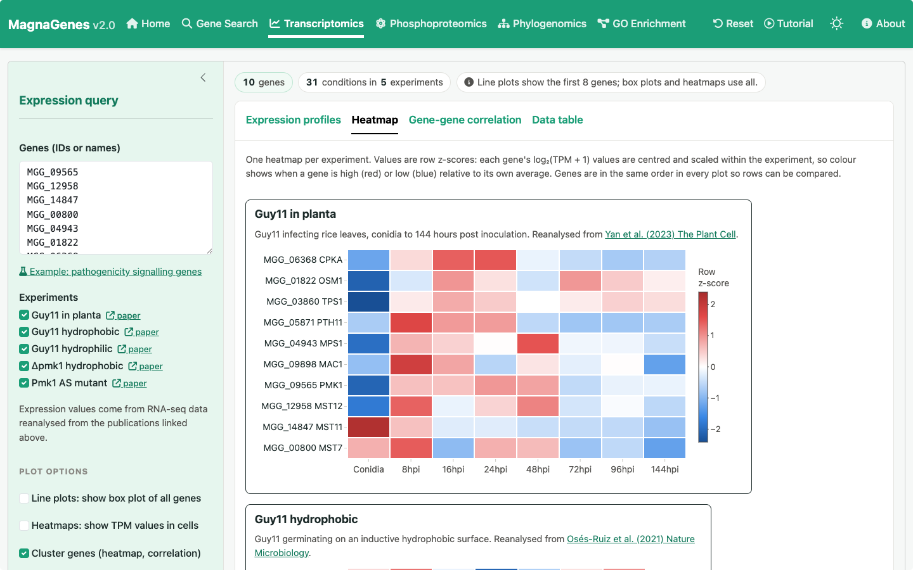
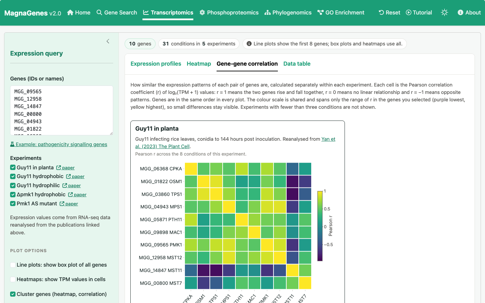
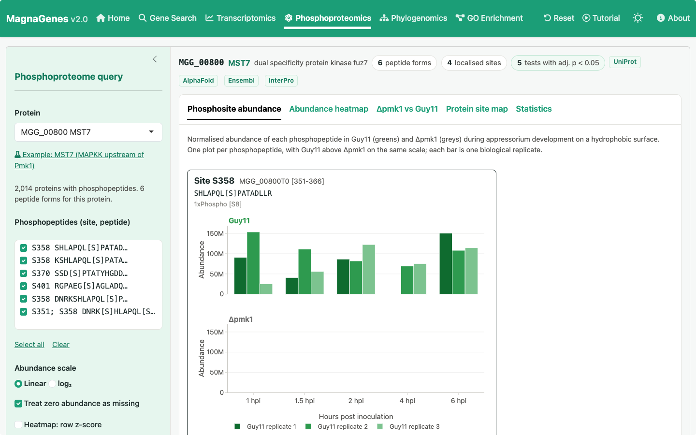
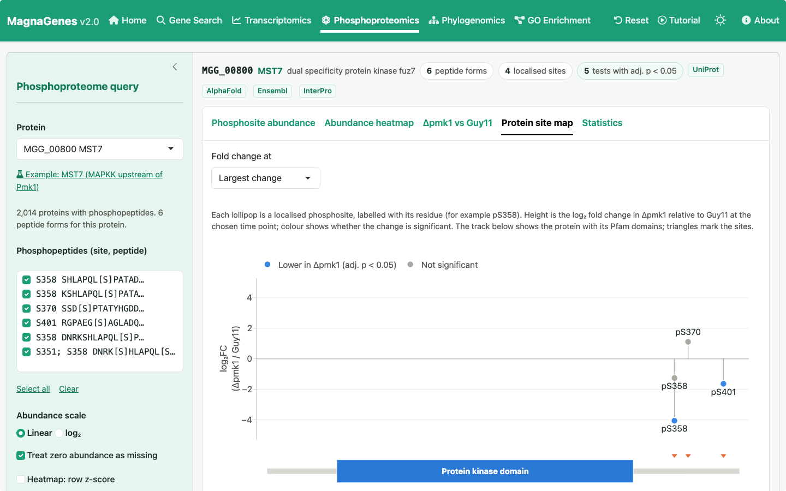
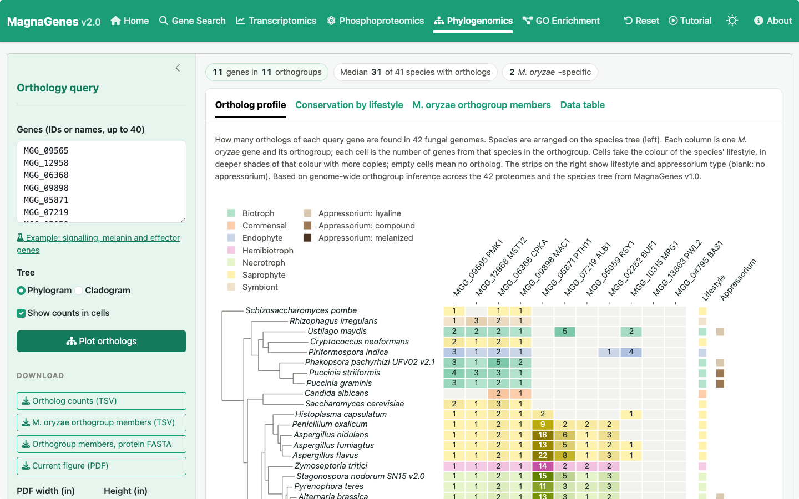
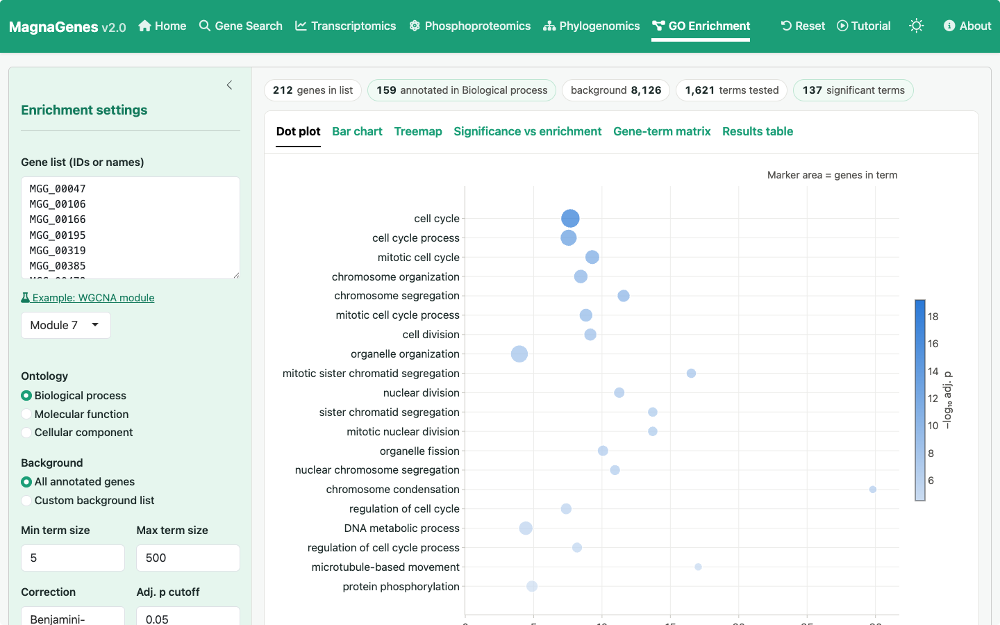
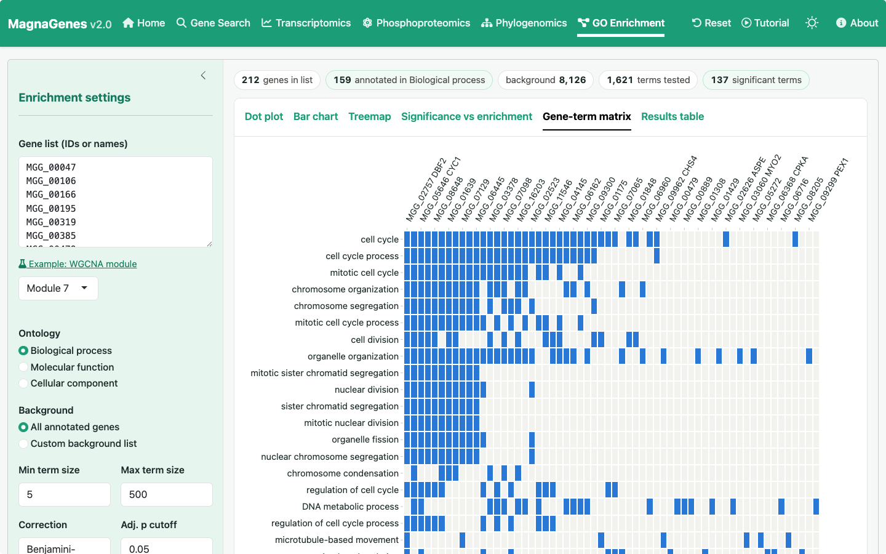

# MagnaGenes v2.0

An integrated multi-omics explorer for *Magnaporthe oryzae* (*Pyricularia oryzae*), the rice blast fungus. It runs entirely in the web browser with [Shinylive](https://posit-dev.github.io/r-shinylive/) (R compiled to WebAssembly), so it needs no server, no API keys and no AI services, and no data leave the user's computer.

## Visit MagnaGenes v.2.0 at this [link](https://nehasahu486.github.io/magnagenes_v2/)

MagnaGenes v2.0 is an extension of MagnaGenes v1.0 by Andrew Foster: <https://zenodo.org/records/4647766>.

## Features

| Tab | What it does |
|---|---|
| Gene Search | Search by MGG ID, gene name (e.g. `PMK1`) or keyword in any annotation field. Gene profiles show genome location, InterPro/Pfam domains, mutant phenotypes, literature, an expression chart and a protein architecture diagram, with links to UniProt, AlphaFold DB, Ensembl Fungi, InterPro, Pfam and PubMed. Exports annotation TSV and protein/CDS FASTA. |
| Transcriptomics | TPM line plots per experiment (error bars when replicate values are available, optional box plot of all genes), clustered row z-score heatmaps with optional TPM labels, gene-gene Pearson correlation per experiment on a range fitted to the selected genes, and a data table across 31 conditions in 5 experiments. |
| Phosphoproteomics | One plot per phosphopeptide with Guy11 above Δpmk1 (bars are biological replicates), abundance heatmaps, log2 fold-change heatmaps with Welch t-tests (BH-corrected), and a protein site map with labelled sites and Pfam domains. |
| Phylogenomics | Ortholog counts across 50 fungi aligned to the species tree (phylogram or cladogram), annotated by lifestyle and appressorium type; conservation by lifestyle; M. oryzae orthogroup members with FASTA export. |
| GO Enrichment | Fisher's exact test (hypergeometric) on propagated GO annotations, BH or Bonferroni correction, optional custom background, dot or lollipop plot, bar chart, treemap, significance-vs-enrichment plot, gene-term matrix and results table with QuickGO links, in a colour of your choice. Replaces topGO, which does not run in WebAssembly. |

The site has a light/dark theme switch, a Reset button and a Tutorial button with a video tour and clickable chapters. Every chart can be saved as a vector SVG from its toolbar (camera icon), and every tab has PDF, TSV and (where relevant) FASTA downloads.

## Repository layout

```
app/                        everything the website needs
  app.R                     the whole application (UI + server in one file)
  data/*.rds                compact data bundle (about 10 MB), built from data-raw/
  www/                      images used by the app
data-raw/                   how the data are built (see data-raw/README.md)
  prepare_data.R            builds app/data/ from the raw files
  metadata/                 rnaseq_experiments.csv: experiment labels, order, paper links
  source/                   raw TSV files by data type (not in git; too large)
docs/screenshots/           screenshots used in this README
site-assets/                loading-screen image, tutorial video and its chapter list
build_site.R                Shinylive export plus the loading screen
tests/smoke_test.R          renders every output and download
tools/record_tutorial.py    re-records the tutorial video (optional; needs Playwright)
.github/workflows/          publishes the site to GitHub Pages on every push
```

## Run locally

```r
install.packages(c("shiny", "bslib", "plotly", "ggplot2", "reactable"))
shiny::runApp("app")
```

## Usage examples

Screenshots below were taken with the example inputs that each tab provides (click the example link in the sidebar to load them).

### Home page

The home page summarises the data in the database and links to each tool.


### Gene Search

Search by MGG ID, gene name or keyword. Here `PMK1, MST12` and the keyword `melanin` return matching genes with their annotation, WGCNA module and links to UniProt, AlphaFold DB, Ensembl Fungi and InterPro. The "Send to" buttons pass the results to the other tabs. Keywords are matched as written, not as natural language, so single words such as `melanin` or `membrane` work best.



The Gene profile tab shows one gene in detail: genome location, protein length, InterPro and Pfam domains, mutant phenotype and literature references.



### Transcriptomics

Expression profiles of the example pathogenicity signalling genes. Each experiment has its own plot in TPM, with a link to the source paper.



Heatmaps show row z-scores, so the colour shows when each gene is high (red) or low (blue) within an experiment.



Gene-gene Pearson correlation, calculated separately within each experiment. Genes are in the same order in every plot and share one colour scale.



### Phosphoproteomics

Phosphosite abundance for MST7, the MAPKK upstream of Pmk1. Each plot is one phosphopeptide, with Guy11 (greens) above the Δpmk1 mutant (greys); each bar is a biological replicate. Phosphorylation of MST7 S358 is not detected in Δpmk1.



The protein site map shows the log2 fold change in Δpmk1 relative to Guy11 for each localised site, above the protein and its Pfam domains.



### Phylogenomics

Ortholog counts for the query genes across 50 fungal genomes, arranged on the species tree. Cells take the colour of each species' lifestyle, in deeper shades with more copies; the strips on the right show lifestyle and appressorium type.



### GO Enrichment

Enrichment of Biological process terms in WGCNA module 7 (Fisher's exact test, Benjamini-Hochberg correction). Marker size is the number of genes in the term and colour is the adjusted p value.



The gene-term matrix shows which genes drive each enriched term.



## Curation

MagnaGenes v2.0 is curated automatically with newly published *Magnaporthe* research using [**Magna-Mined**](https://github.com/nehasahu486/magna-mined), an automated literature mining and evidence-extraction pipeline. Automated literature curation is planned to run **every six months**, and the full curation and release record can be found in the **Version history** section under the **About** tab in the app (last curation: **11 Nov 2026**).

## Data sources

1. **MagnaGenes v1.0**: Foster AJ, Were VM, Yan X, Win J, Harant A, Langner T, Kamoun S, Talbot NJ (2021). MagnaGenes: an open science database of gene function studies in the blast fungus *Magnaporthe oryzae*. Zenodo. [doi:10.5281/zenodo.4647766](https://zenodo.org/records/4647766). Curated gene annotation (BLAST2GO, InterPro, Pfam, KEGG, mutant phenotypes, effector predictions, literature) and GO annotation.
2. **Transcriptomics, Guy11 in planta (conidia to 144 hpi) and WGCNA modules**: Yan X, Tang B, Ryder LS, *et al.* (2023). The transcriptional landscape of plant infection by the rice blast fungus *Magnaporthe oryzae* reveals distinct families of temporally co-regulated and structurally conserved effectors. *The Plant Cell* 35: 1360-1385. [doi:10.1093/plcell/koad036](https://doi.org/10.1093/plcell/koad036)
3. **Transcriptomics, Guy11 on hydrophobic and hydrophilic surfaces and Δpmk1 on a hydrophobic surface**: Osés-Ruiz M, Cruz-Mireles N, Martin-Urdiroz M, *et al.* (2021). Appressorium-mediated plant infection by *Magnaporthe oryzae* is regulated by a Pmk1-dependent hierarchical transcriptional network. *Nature Microbiology* 6: 1383-1397. [doi:10.1038/s41564-021-00978-w](https://doi.org/10.1038/s41564-021-00978-w)
4. **Transcriptomics, Pmk1 analogue-sensitive mutant (active vs inhibited)**: Sakulkoo W, Osés-Ruiz M, Oliveira Garcia E, *et al.* (2018). A single fungal MAP kinase controls plant cell-to-cell invasion by the rice blast fungus. *Science* 359: 1399-1403. [doi:10.1126/science.aaq0892](https://doi.org/10.1126/science.aaq0892)
5. **Phosphoproteomics, Guy11 and Δpmk1 during appressorium development**: Cruz-Mireles N, Osés-Ruiz M, Derbyshire P, *et al.* (2024). The phosphorylation landscape of infection-related development by the rice blast fungus. *Cell* 187: 2557-2573. [doi:10.1016/j.cell.2024.04.007](https://doi.org/10.1016/j.cell.2024.04.007)
6. **Orthology**: hierarchical orthogroups (OrthoFinder 3) across 50 fungal proteomes and the species tree rooted on *Rhizophagus irregularis*, with lifestyle and appressorium annotation, generated for MagnaGenes v2.0 (not previously published).
7. **Genome and sequences**: [Ensembl Fungi](https://fungi.ensembl.org/Magnaporthe_oryzae/) release 60, *M. oryzae* MG8 (strain 70-15): protein and CDS sequences, chromosome coordinates and UniProt cross-references.
8. **Gene Ontology**: term names and ontology structure from the [Gene Ontology](https://geneontology.org/) via the Bioconductor GO.db package.

Gene profiles also link out to [UniProt](https://www.uniprot.org/), [AlphaFold DB](https://alphafold.ebi.ac.uk/), [InterPro](https://www.ebi.ac.uk/interpro/), [Pfam](https://www.ebi.ac.uk/interpro/entry/pfam/) and [PubMed](https://pubmed.ncbi.nlm.nih.gov/).

## Citation

If you use MagnaGenes v.2.0 in your research, please cite:

Sahu N. (2026) MagnaGenes v.2.0: an integrated multi-omics explorer for the rice blast fungus *Magnaporthe oryzae*. <https://nehasahu486.github.io/magnagenes_v2/>

## Contact

neha.sahu.tsl@gmail.com
